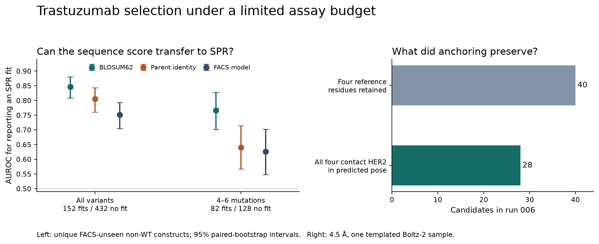

# Which evidence transfers to the next HER2 assay?

**14 November 2026.** The team can defend a specific change in selection. A frozen classifier predicts the high FACS class extremely well, even on a published sequence-family split. A simple substitution score has the stronger association with the historical SPR endpoint. Only three independent-of-FACS historical constructs satisfy the enumerated shortlist's anchor, chemical-site, mutation-count and cysteine constraints. That is the limit of the direct evidence for this particular panel.

## Retrospective experiment on the supplied HER2 data

**Population.** Start with 768 SPR observations. Keep the 740 ten-mers with the same verified VH framework and VL as trastuzumab. Remove 37 rows found in the FACS screen and remove all eight WT measurements. This leaves **695 distinct non-WT constructs**. The code also checks repeated constructs for conflicting labels. Among these, 152 have a quantitative KD, 432 had no reportable KD, 98 were inconclusive and 13 were unreported. The last two categories carry no usable fit-status label here. Retain them in the coverage ledger. All comparisons below use the same eligible rows for each endpoint. [Script](review/assay_transfer.py) · [Results, counts and input hashes](review/evidence/assay_transfer.json)

**Comparators.** The frozen model supplies its existing probability for the high FACS class. The BLOSUM62 score sums the substitution-matrix entries against the WT loop, position by position. Identity simply counts unchanged positions. Both baselines require no training or fitted weights. Exact FACS exclusion prevents direct train/test duplication. This shares a campaign, an antigen and a framework with the training data, and some SPR variants were originally selected by a BLOSUM-based method. The comparison is retrospective and conditional on which proteins the authors chose to measure. [Chinery et al., v2](https://doi.org/10.1101/2024.03.26.586756) · [FACS split archive](https://doi.org/10.5281/zenodo.10831512)

| Score | Fit reportability AUROC, 152 fitted / 432 no fit | Spearman ρ with log KD, 152 fitted | AUROC among 4–6 mutations, 82 fitted / 128 no fit |
|---|---:|---:|---:|
| Frozen FACS classifier | 0.751 [0.705, 0.793] | −0.339 [−0.483, −0.184] | 0.626 [0.548, 0.702] |
| BLOSUM62 to parent | **0.847 [0.809, 0.880]** | **−0.496 [−0.614, −0.368]** | **0.766 [0.701, 0.827]** |
| Parent identity | 0.805 [0.761, 0.844] | −0.431 [−0.559, −0.296] | 0.640 [0.567, 0.714] |

Brackets are 95% percentile intervals from 2,000 paired construct resamples with a fixed seed. The AUROC bootstrap preserves class counts and uses the same sampled constructs for each score. The fitted-KD bootstrap resamples only quantified constructs. Negative ρ means higher predicted score corresponds to lower measured KD. BLOSUM62's paired AUROC advantage over the classifier is **+0.095 [0.061, 0.132]** overall and **+0.140 [0.062, 0.222]** at 4–6 mutations. Across 5,798 fitted/no-fit pairs matched exactly on mutation count, concordance is 0.761 for BLOSUM62, 0.577 for the classifier and 0.500 for identity. The pairs share constructs. Neither the pair count nor the bootstrap resolves selection-method or experimental-batch confounding. [Full estimates](review/evidence/assay_transfer.json)

**Where inference stops.** Within the 4–6 mutation fitted subset, classifier ρ is −0.075 [−0.293, 0.145], compared with −0.260 [−0.444, −0.045] for BLOSUM62. Exactly three historical constructs also keep all four reference identities, change both chemical-site residues and omit cysteine in the loop. All three have fitted KD. There are zero no-fit examples in that subgroup, so AUROC and a reliable absolute hit probability cannot be estimated. Historical provided constructs themselves are excluded by the competition novelty rule. The three historical analogues quantify coverage of this sequence regime. Preserve uncertainty when choosing from the 40 novel candidates.

**Why the discrepancy is credible.** The team's original 85/15 random split gave high-class AUROC 0.993. We cloned the same three-class GBM recipe into two fresh CPU fits on the published partitions, using the prescribed training rows only. Exact sequence overlap was zero across train/validation/test. For the clonotype split, cluster-centre overlap was also zero. The test sets give AUROC 0.9930 (random, 78,652) and 0.9939 (clonotype, 78,651). Average precision was 0.9870 and 0.9883, Brier score 0.02965 and 0.02925, respectively, with 32.8% high-class labels. In the 0.9–1.0 bin of the clonotype test, mean score was 0.975 and observed high fraction 0.994 (18,679). This partition provides little evidence for a family-split performance collapse. Calibration for high FACS class cannot be transferred numerically to KD, Tm or probability of passing the competition. [Fresh fits and bins](review/evidence/split_check.json) · [Methods](review/split_check.py)

## A second comparator that could have changed the decision

During the review another teammate produced a 20-design shortlist ordered by the mean of the gradient booster and a newly fitted FACS logistic regression. Their report also introduced the distance to the nearest of 172,149 experimentally high-FACS loops as a comparator. We used both saved models, reproduced the team's published mean scores on all 20 and compared all six methods on the same 584 labelled historical SPR constructs. The logistic regression gave AUROC **0.664**, the two-model mean **0.730**, and negative distance to the nearest FACS-high loop **0.849**. BLOSUM62 exceeded the mean by **0.117** (paired 95% interval **0.081–0.156**). Its difference from the nearest-high rule was **−0.003** (**−0.025 to +0.020**). These two simple baselines are indistinguishable at this precision. The nearest-high rule also had the strongest fitted-only association with KD (ρ = −0.532). [Late comparator analysis](review/evidence/late_comparison.json)

**What the contest changes.** All 40 enumerated novel designs were exactly three substitutions from their nearest high-FACS sequence. The strongest historical score therefore assigns them all the same value. The parent substitution score spans 19–40, with 15 distinct values, and retains the stronger concordance at fixed mutation count (0.761 versus 0.717 for nearest-high). This gives a specific reason to prefer BLOSUM as an ordering feature within this panel. It also limits the scope of any claimed improvement to ranking hypotheses. The FACS ensemble's alternative 20 and the proposed 20 share ten pairs and none of their top four. That disagreement is worth documenting before experimentation. [Frozen comparator implementation](review/late_comparison.py) · [Proposed full sequence pairs](review/evidence/panel.csv)

In the entire distance-three historical subgroup, a fitted KD was available for **53 of 142 assessable constructs** (37.3%, descriptive Wilson 95% interval 29.8–45.5%). Another 26 were inconclusive and one unreported. Restricting to four to six parent mutations changed the rate to **42/99** (42.4%, interval 33.2–52.3%). Conditioning on all the enumerated design rules leaves only the three fitted examples above. These different denominators explain why assigning a 37% hit probability to each novel design would overstate the evidence. The intervals treat constructs as independent and omit library-selection uncertainty. [Stratified outcomes](review/evidence/late_comparison.json)

## Evidence from published studies

| Finding and primary source | Evidence and limit | Decision possible today |
|---|---|---|
| Simple sequence baselines are serious competitors in this exact system. [Chinery et al., HER2 study, v2 preprint](https://doi.org/10.1101/2024.03.26.586756) | The authors tested 720 new designs from five approaches by SPR. Their substitution-based approach yielded nine subnanomolar binders and outperformed the four deep-learning design methods on their reported enrichment. Method-selected panels and one antibody limit transfer. | Compare the saved model with a fixed BLOSUM62 score on the identical SPR constructs. Treat this paper as the origin of the baseline. The paired, mutation-matched audit of our own model and its coverage gap is the team contribution. |
| A sequence classifier can identify HER2 specificity prospectively. [Mason et al.](https://doi.org/10.1038/s41551-021-00699-9) | All 30 experimentally tested variants drawn from the authors' selected library retained HER2 specificity. Mammalian display, their library and specificity endpoint differ from this competition's three measurements. | Keep FACS ranking as an orthogonal-to-coordinates triage feature. Its screening evidence supports keeping candidates in contention. |
| Accuracy is task-dependent even in prospective blinded studies. [Erasmus et al., AIntibody](https://doi.org/10.1038/s41587-026-03238-6) | 511 antibodies, 29 organisations, three tasks. Some very-high-affinity developable designs succeeded. In the within-cluster ranking task, all but one model fell below random clone selection. Platforms, libraries and endpoints differ from our panel. | Show task-specific metrics and baseline comparisons. Register the proposed order before Adaptyv testing. Comparing today's scores to another retrospective threshold cannot replace that prospective check. |
| Confidence can overlap across correct and shuffled VHH–antigen pairings. [Smorodina et al., preprint](https://doi.org/10.64898/2026.03.02.709004) · [Score archive](https://doi.org/10.5281/zenodo.18390239) | The study included 106 cognate systems, 11,342 shuffled pairings and three models. In our common subset with complete values from all three matrices, there are 89 cognate and 7,902 shuffled pairs. At ipTM ≥0.70, 7,448 shuffled pairs pass Boltz-2, 240 pass AF3 and 17 pass Chai-1. Shuffled pairs are decoys with generally unknown experimental outcomes. | A universal ipTM cutoff is model-dependent. Use the same inputs and WT, show the score's chain scope and retain the separate experimentally characterised examples. |
| Structural scores can carry genuine signal in some antigen-specific panels. [Abbate et al.](https://doi.org/10.3389/fimmu.2026.1951538) | In a GFRAL–DTA study the authors report Pearson correlation −0.48 between AF3 interface confidence and SPR KD. Heavy/light interchain confidence was generally higher than antibody/antigen confidence. Antigen, display history, model and input differ here. | Keep an antigen-specific structural tie-breaker and show contradictory cases. A target-matched, labeled calibration set could change its weight. |
| Prospective developability prediction is particularly difficult for Tm. [van Niekerk et al.](https://doi.org/10.1080/19420862.2026.2634216) · [Original ten-assay platform](https://doi.org/10.1080/19420862.2025.2593055) | A blinded challenge trained on 246 clinical antibodies and tested 80. Best held-out Spearman ρ was 0.392 for thermostability and 0.310 for expression titer. The preceding platform measured 246 antibodies across ten assays. Clinical IgG and an altered therapeutic Fv have different domains, protocols and endpoints. | Leave Tm and expression as separate unknowns. This negative benchmark, surfaced by AMASS, moved a new stability model below direct assay planning. |
| Oxidation and isomerization are documented chemical liabilities. [Harris et al.](https://doi.org/10.1016/S0378-4347%2800%2900548-X) · [Spanov et al.](https://doi.org/10.3389/fchem.2021.794247) · [Hensel et al.](https://doi.org/10.1371/journal.pone.0017708) · [CT-P6 stability study](https://doi.org/10.1007/s40259-018-0314-1) | Charge-variant mapping implicated Asp102 isomerization in a lower-potency fraction. Spanov observed it under stress in free WT and below detection in complex. Met107 oxidation sensitivity and monitoring are documented. The CT-P6 infusion study observed no change under its tested storage conditions. These are condition-specific WT studies. | Record the two changed sites as a chemical hypothesis. Chemical aging, equilibrium melt and expression have separate evidence requirements. A replacement can introduce other liabilities. |
| Measured binding, functional activity and thermal behavior can diverge. [Ng et al.](https://doi.org/10.1080/19420862.2025.2532117) · [Moon et al.](https://doi.org/10.14348/molcells.2016.2235) | Ng's trastuzumab framework study found a mutation retaining antigen binding while impairing measured Fab/Fc functions. Moon's AH06 improved affinity 7.4-fold and potency in one cell line, with a model proposing a role for a distal antigen contact. Neither establishes those changes for our designs. | Use the reported prior art to bound the novelty claim. Restrict the pitch to lead selection. Our input ends at HER2 607 and cannot score a proposed contact at 613. |
| Crystal contacts and competition supply different information. [Cho et al., 1N8Z](https://doi.org/10.1038/nature01392) · [Abdiche et al.](https://doi.org/10.1371/journal.pone.0169535) | The measured crystal complex has 2.52 Å resolution. Biosensor experiments on antibody panels show that even adjacent or minimally overlapping epitopes can generate competition/displacement. A template-conditioned structure can impose the parent pose. | Score contacts by author residue ID at several distances. Call the outcome predicted footprint agreement. Adaptyv competition is the judged readout. |
| Structural conditioning of trastuzumab CDR loops already has methodological prior art. [Fv Hallucinator](https://doi.org/10.3389/fimmu.2022.999034) · [WO2025122885A1, Figs. 25–26](https://patents.google.com/patent/WO2025122885A1/en) | The paper includes structural benchmarks and computational HER2 designs. The published patent application describes AI-optimised anti-HER2 examples and epitope mapping including the 581–590 loop, the part missing from our cropped input. The patent provides applicant-reported examples. Scope and freedom to operate require a separate legal analysis. | Cite these precedents. The crop can prevent observing distinctions exactly where another group sought them. The defensible originality claim concerns how the team audited and acted on its evidence. |
| A clinically useful HER2 product depends on its format and indication. [KATHERINE trial](https://clinicaltrials.gov/study/NCT01772472) · [Primary trial report](https://doi.org/10.1056/NEJMoa1814017) · [EMA Kadcyla record](https://www.ema.europa.eu/en/medicines/human/EPAR/kadcyla) | In 1,486 patients with residual invasive HER2-positive disease, the randomised trial compared the conjugate T-DM1 with trastuzumab. Three-year invasive disease-free survival was 88.3% versus 77.0%. Evidence belongs to those therapies in that setting. The platform models isolated variable domains. | Target the assay lead or discovery team as the first user. The route to value is better allocation of follow-up experiments. Linker, payload, effector function, exposure, safety and clinical benefit each require their own programmes. |

The Adaptyv EGFR competition selected 601 proteins for expression and binding characterisation from over 1,800 submissions. It used another antigen and BLI. It supports keeping expression failure observable and recording who was selected for measurement. General uncertainty studies likewise show that confidence can degrade when the input distribution shifts. The directly relevant estimates here come from the HER2 assay and score comparisons above. [Cotet et al., preprint](https://doi.org/10.1101/2025.04.17.648362) · [Ovadia et al.](https://proceedings.neurips.cc/paper/2019/hash/8558cb408c1d76621371888657d2eb1d-Abstract.html)

## How to use the two kinds of negative evidence

On the common VHH matrices, cognate-versus-shuffled AUROC was 0.759 for AF3, 0.640 for Boltz-2 and 0.568 for Chai-1. Pairwise Spearman correlations across the shuffled pairs were only 0.18–0.21. All three face the same 7,991 labeled pair identities for this comparison, extracted from the supplied 91×91 tables. Reused receptors/antigens induce dependence. These retrospective figures describe pair identity. An HER2 false-positive rate would require measured outcomes on comparable Fab variants. The event separately reports 21/454 *measured* VHH negatives with AF3 ipTM ≥0.7. The organisers reported this figure. Independent verification would require the corresponding 454-row labelled dataset. [Local replay](review/evidence/vhh_controls.json) · [Source data and supplement](https://doi.org/10.64898/2026.03.02.709004)

The 29-row SPR supplement contains four quantified KD, one binding response without fitted KD, 12 with no reportable fit, seven expression failures and five missing antigens. A CD4 cognate measured at 7.41 nM despite AF3 ipTM 0.12. This positively measured counterexample and the incomplete negative evidence answer different questions. Keep the separate 14-target cross-reactivity screen apart because it used a different provider/selection protocol. No kd value was imputed for a nonfit or unavailable antigen. [Dataset source](https://doi.org/10.11582/2026.owjnnp5q) · [Reproduced summary](review/evidence/vhh_controls.json)

## AMASS retrieval and expenditure

The connected SSH host authenticated against the official AMASS REST API. Before paid calls, the admin balance endpoint returned **10,495 credits**. Eight searches at limit 20 were budgeted at five credits each. One batch DOI lookup and six selected record fetches used seven further credits. Per-request cost headers sum to **47 credits = US$0.47**. The final free balance check returned **10,448 credits = US$104.48**. An earlier unauthenticated balance probe returned 401 and consumed no credits. Prior team searches and other teammates' activity are outside this ledger. [Provider pricing](https://platform.amass.tech/documentation/getting-started/pricing) · [Sanitized query, retrieval and cost ledger](review/evidence/amass_ledger.json)

| Search | Returned | Findings used or disposition |
|---|---:|---|
| BiomedCore — binder-enriched antibody libraries | 20 | Retrieved Fv Hallucinator, PMID 36341416. The intended Chinery preprint was absent from the search and the exact-DOI lookup. Verified separately via the authors' preprint record and source data. |
| BiomedCore — blinded prospective benchmark in silico antibody discovery | 20 | Erasmus AIntibody and van Niekerk's Ginkgo benchmark both retrieved and fetched by Amass ID. The prospective Tm result directly changed our priorities. |
| BiomedCore — Structural Plausibility Without Binding Specificity | 20 | Low-relevance lexical matches. The Smorodina DOI was also missing from the batch lookup. Used the authors' preprint, Zenodo and the local matrices instead. |
| BiomedCore — Trastuzumab HER2 Complex Formation Stress Induced Modifications | 20 | Spanov, PMID 35047480, retrieved and fetched. Free versus antigen-bound stress behavior substantiates the chemical interpretation. |
| BiomedCore — high-throughput biophysical antibody developability assessment | 20 | The ten-assay platform and predictive antibody profiler were returned. Original platform paper checked against its primary abstract. |
| TrialCore — NCT01772472 | 1 | KATHERINE matched by registry ID, then fetched and checked against ClinicalTrials.gov and the primary trial report. |
| PatentCore — anti HER2 associated antibody compositions designed by artificial intelligence | 20 | WO2025122885A1 retrieved and fetched, figures and examples checked in the publication itself. |
| RegulatoryCore — Kadcyla | 6 | FDA and EMA product records retrieved. Specific EMA record fetched and checked at source. |

The ledger records all 127 search hits including irrelevant leads, original IDs, query times, exact DOI misses and billed headers. Five of eight exact DOI identifiers resolved. The Chinery, Smorodina and Adaptyv preprints were verified outside AMASS. Abstracts or public source records were sufficient for the claims above except where named sections, figures or local data were inspected. These were targeted searches. A systematic review or a patent clearance assessment would require broader coverage.
