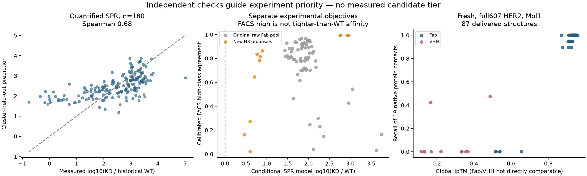

# Ny evaluering, trening og sekvensgenerering

Oppdatert 2026-11-14T16:22:30.199000+00:00. Dette er en gjennomgått statusrapport; jobber som fortsatt kjører står i [status.json](status.json). Ingen kandidat har fått bekreftet S-, A- eller B-tier.

## Hva som faktisk er nytt

- Ny trening fra de originale målingene, uten gamle modellvekter, lagrede sannsynligheter eller tidligere rangering som fasit. 524,309 FACS-sekvenser etter at alle SPR-overlapp er holdt ute. Trening, kalibrering og test har adskilte mønstre ved fire native kontaktposisjoner. Dette er en strengere skaffoldintern test, ikke et bevis på overføring til ukjente antistoffamilier.
- To FACS-modeller: test-AUC 0.971 og 0.926. De modellerer skjermingsklasse, ikke sannsynlighet for S-tier. Sammenhengen med kvantitativ SPR er svak, og endepunktene blandes derfor ikke.
- En separat modell for faktisk rapportert SPR-KD, 180 unike konstruksjoner, 126 sekvensklynger. Klynseholdt-ute Spearman 0.675, MSE 0.651 mot konstant-baseline 1.054. Dette er betinget på målbart KD; manglende fit er ikke fylt inn som et negativt bindeforsøk.
- 200,000 nye forslag trukket deterministisk fra WT og seks målte foreldre; 182,595 ulike etter WT-identitetsfilter, 1,062 bestod av de 2 000 modellprioriterte forslagene. 68 råforslag beholdt. Et tak på 64 ble overskredet fordi løkken fullførte en Pareto-front; løkken er rettet, og de opprinnelige 68 er bevart for sporbarhet.
- 12 nye H3-foreldre pluss fire matchede rammeverksvarianter er valgt til ny strukturevaluering. **Alle 16 består lokal abguard med eksplisitt referanse.** Filen [16_VALIDERTE_NYE_FAB.csv](16_VALIDERTE_NYE_FAB.csv) er en valideringsbatch, ikke en ferdig rangert innsendingsfil.
- Hele HER2s 607 aminosyrer, ny seed 271828, ingen inputtemplate/hotspots: 87 opprinnelige kandidater/kontroller og 17 nye sekvens-/rammeverkstester. OpenDDE gir en separat modellkontroll av 25 forhåndsvalgte mål. Begge modellene er fortsatt beregninger; én seed gir ikke robusthetsbevis.
- Ny bindingsenergi på den eksperimentelle 1N8Z-strukturen: 76 varianter, inkludert 12 nye målte kontrollkonstruksjoner. Kontrollkorrelasjon 0.32, 95 % konstruksjonsbootstrap [-0.35, 0.83]. **For usikkert til å styre rangeringen.** MC-standardfeilen er ikke prediksjonsusikkerhet. Denne modellen predikerer binding, ikke varmestabilitet.

## Feil og svake antakelser i tidligere skript

1. `multiseed_analysis.py` brukte øvre grense for å hevde non-inferiority. Det krever nedre grense. 4 historiske unike sekvenser hadde fått en slik merkelapp uten tilstrekkelig nedre grense. Rettet. Selv korrekt statistikk for modellskår er ikke et bevis på like god biologisk binding.
2. `novelty.py` brukte Hamming for like lange sekvenser, selv om funksjonen lovet edit distance. Rettet til eksakt Levenshtein. **Dette endret ingen av de 98 eksisterende Fab-sekvensenes nærmeste avstand**; en regresjonstest viser feilen på et skiftet sekvenseksempel. CLI-grensene er også strammet til den strengere PDF-varianten. 18 råsekvenser som passerte de gamle løse tallgrensene, faller utenfor den nye konservative full-IMGT-kontrollen.
3. `collect_refold.py` valgte første seed med `glob`. Flere treff krever nå eksplisitt seed, og tvetydige run-navn avvises. Sammenligning av modellkonfidens med WT beskrives som modellkonfidens, uten biologisk avvisningspåstand.
4. Første-pass-filtrene krevde bestemte kontaktrester, høy pHigh og fjerning av både D/M. Dette er hypoteser, ikke hackathonkrav eller målte Tm-forbedringer. Ny generering har myke priorer, uten disse hardkravene.
5. Beste seed, kopiert kompleks-template og en kort HER2-region kan gi for pene skårer. Den nye evalueringen bruker hele antigenet og blind refolding. Seed og kontekst er endret samtidig; forskjeller isolerer derfor ikke effekten av hver av dem.
6. FACS, kvantitativ KD, assay-reportability, konkurranse og Tm er ulike utfall. Predikerte 1,8 millioner komplekser er ikke 1,8 millioner målte bindere. Ingen nye Adaptyv-labresultater finnes for våre design.

Kodediff: [SOURCE_CHANGES.diff](SOURCE_CHANGES.diff). Regresjonstester for blant annet grenseverdier, feil seedvalg, riktig kjederolle, speiling, PAE og native kontakter ligger i `evidence/regression-tests.log`; 11 nye tester består. De eksisterende skår- og evidenstestene bestod også (5 + 7).

## Hva figurene betyr

Venstre: hvor godt den nye affinitetsmodellen predikerer holdt-ute målte konstruksjoner. Midten: ny generering søker også lavere modellert KD; høy FACS-klasse alene er utilstrekkelig. Høyre: modellkonfidens og overlapp med den native kontaktflaten er separate størrelser. Fab-global-ipTM inkluderer også VH–VL-interaksjonen og kan ikke sammenlignes direkte med VHH-ipTM.

pLDDT beskriver lokal strukturkonfidens; H3 rapporteres separat fra det ofte sikre rammeverket. Kontakt-PAE beregnes med verifisert tokenrekkefølge og begge retninger, én gang per kontaktpar. 19 kontaktrester ved 4,5 Å rekonstrueres fra native 1N8Z. Kontakt-recall og Jaccard er geometriske hypoteser om epitope, ikke et målt konkurranseforsøk. RMSD rapporteres etter hele-antigen-, bindingsdomene- og epitopejustering for å synliggjøre domeneledding. Manglende PAE blir tomt, aldri null.

## Innenfor hackathonkravene

| Krav | Praktisk håndtering |
|---|---|
| Én rangert liste, høyst 20 | 18 optimaliseringer + 2 de novo er tillatt. Ikke send hele råpoolen. |
| Topp N går til lab; fire garantert | Plasser begge spor blant topp fire dersom dere vil sikre forsøk i begge. Det reduserer antall optimaliseringer blant de fire. |
| VHH, scFv eller parret variabel Fab; totalt ≤250 aa | Nye Fab er VH120 + VL107 =227 aa. Validator kontrollerer type/lengde/nummerering. |
| Nummereringskonfidens ≥0,1; ingen uparrede cysteiner | Kjøres gjennom installert abguard med eksplisitt referanse og beholdt kvittering. Et enkelt oddetallssjekk alene er utilstrekkelig. |
| Optimalisering: H3-identitet <70 %, >2 mutasjoner fra de oppgitte sekvensene | Bruk full IMGT-H3, eksakt edit distance og alle 525 063 oppgitte løkker. Den strengere PDF-varianten håndterer avviket fra de løsere lysbildene. |
| De novo: <70 % mot nærmeste kjente antistoff; H3 minst to mutasjoner fra WT | Lokale kontroller + ny RCSB-søk/riktig variabeldomene. **Endelig databasekrav er ikke dokumentert bestått:** installert abguard sammenligner fullsekvens mot trastuzumab og har en H3-referanse; dette erstatter ikke hele Adaptyvs database. |
| S-tier etter tre målte egenskaper | SPR, konkurranse mot trastuzumab og direkte varmestabilitet, sammenlignet med samtidig målt WT. Ingen modellskår gir S-tier på forhånd. |

103 strukturer er foreløpig evaluert og 2 deljobber kjører i dette øyeblikksbildet. CSV-er og kvitteringer viser hva som er levert, mangler eller feilet. Maskinvarefeil blir ikke tolket som negative biologiske resultater.

## En sterk og redelig brystkreftcase

«Vi bygger en etterprøvbar preklinisk plattform som velger nye bindingsmoduler mot HER2 ved HER2-positiv brystkreft. Vi forbedrer utvelgelsen med faktiske målinger, bevarer det relevante epitope som hypotese, og tester en separat rammeverksstrategi for varmestabilitet. Vi forkaster rangeringer når modellene ikke består kontrollene.»

Trastuzumab er etablert ved HER2-positiv brystkreft; [EMA](https://www.ema.europa.eu/en/medicines/human/EPAR/herceptin) gir den kliniske konteksten. Våre fragmenter har ingen demonstrert behandlingseffekt eller Fc-mediert funksjon. Neste trinn er uttrykk, SPR/konkurranse/Tm med WT-kontroll, deretter cellebinding og riktig terapeutisk format før funksjon og videre preklinisk utvikling kan hevdes.

Den nye rammeverksgrenen bruker **VH S85N/R87T** fra [Ng mfl., mAbs 2025](https://doi.org/10.1080/19420862.2025.2532117). Artikkelen rapporterte høyere Tm og bevart HER2-cellebinding for full trastuzumab. Vi har verifisert restene mot artikkelens 7MN8-kjede E, ikke forvekslet dem med IMGT-posisjonene. Endringen lager et NLT-glykosyleringsmotiv; overføring til nye H3-er, Fv og cellefritt uttrykk er uprøvd. Dette er en konkret, testbar stabilitetshypotese, ikke en Tm-prediksjon.

## Reproduserbarhet

Run `014-codex-fresh-evaluation` bevarer rå sekvenser, kildehasher, fryste forespørsler, idempotenskvitteringer, model/seed/antigenkontekst, native referanse og feil. Kodekopien i `code/` viser algoritmene; originalkjøringen skjer fra prosjektets `review/fresh_evaluation/` med de opprinnelige assayfilene og valideringsmiljøet. API-nøkler og innlogging er ikke med i leveransen. Reproduksjon krever samme katalogstruktur, offentlige assaydata/hackathontilgang og API-tilgang. Dette er ikke en selvstendig installasjonspakke eller en garanti for identiske fjernmodellresultater ved senere modelloppdateringer.

## Ny rangering og viktige kontrollresultater

[18+2, optimalisering først](18plus2_DRAFT_optimisation_first.csv) gir Fab blant de fire garanterte og plasserer de to foreløpige de novo ved15/16. [Begge spor blant topp fire](18plus2_DRAFT_both_tracks_top4.csv) flytter VHH til3/4. Dette er **forsøksprioritering, ikke S-tier-prediksjon**. En `..._evidence.csv` følger hver liste. Den endelige lokale kontrollen av standardlisten ga20 av20 godkjente med eksplisitt abguard-referanse. Endelig de novo-databasestatus er fortsatt uavklart.

Listen fordeler forsøk mellom lavere modellert KD, balanse mot FACS-klassen, FACS-sterke alternativer og to konkrete rammeverkshypoteser. H3-diversitet opprettholdes mellom vanlige kandidater; et matchet rammeverkspar deler bevisst H3. Det er ingen offentlig regel som krever at alle nye lagkandidater har ulike H3-er; det er fullsekvensene som er ulike her. Hele panelet valideres samlet. De valgte VHH-ene har svak støtte for riktig bindingsflate. Den ene ligger dessuten svært nær70%-grensen mot et kjent antistoff. **De to plassene er derfor eksplorative, og global novelty kan ikke regnes som ferdig bekreftet.**

En sekundær Gaussian-process-modell er kontrollert med samme fem sekvensklynsefold som hovedmodellen. Kjerneparametere ble lært inne i hver treningsfold. Den gir omtrent samme rangering og litt lavere MSE, uten bevis på sikker overføring til nye konstruksjoner. Dette er en sensitivitetstest valgt underveis, ikke en urørt slutt-test av modellvalg. De empiriske95%-kvantilene for absolutt holdt-ute log10-KD-feil er rundt1,7–1,8: store feil er mulige. Bootstrap-spredningen i parametere kan derfor ikke vises som et snevert biologisk konfidensintervall. Modellene overpredikerer også historisk WT-KD; de er bedre egnet til prioritering enn absolutte affinitetsløfter.

**OpenDDE-kontrollen feiler på WT:** full-context WT gjenfinner bare2 av19 native kontakter. Negative OpenDDE-resultater kan derfor ikke være et hardt avvisningsfilter. Positive sammenfall brukes som ekstra geometrisk støtte, med tydelig begrensning. Mol1-WT gjenfinner19 av19.

En lokal Apheris Boltz-2-kontroll er også gjennomført på H100, med full607-sekvens, HER2-template uten antistoffkoordinater, eksplisitt ingen MSA og seed271828. Alle fem konstruksjoner ble beregnet. Også her sviktet WT-dokkingen (0 av19 kontakter), så negative resultater brukes ikke som avvisning. Rammeverksvarianten av `newML_b973259db36d` traff19 av19; dette støtter en geometrisk hypotese og beviser verken binding eller varmestabilitet. pLDDT og globalipTM er fortsatt bare modellskårer.

For lokal kjøring måtte vi bevare HER2s fulle `_entity_poly_seq` i den eksperimentelle templaten, bruke en skrivbar Numba-cache og en skrivbar hjemmekatalog inne i containeren. Tidligere forsøk stoppet før gyldige prediksjoner og er bevart separat. Ingen modellvekter ble endret. GPU-låsen hindret konflikt med andre på VM-en. Den lokale jobben er en annen kontekst enn Mol1/OpenDDE, og skårene blandes ikke numerisk.
